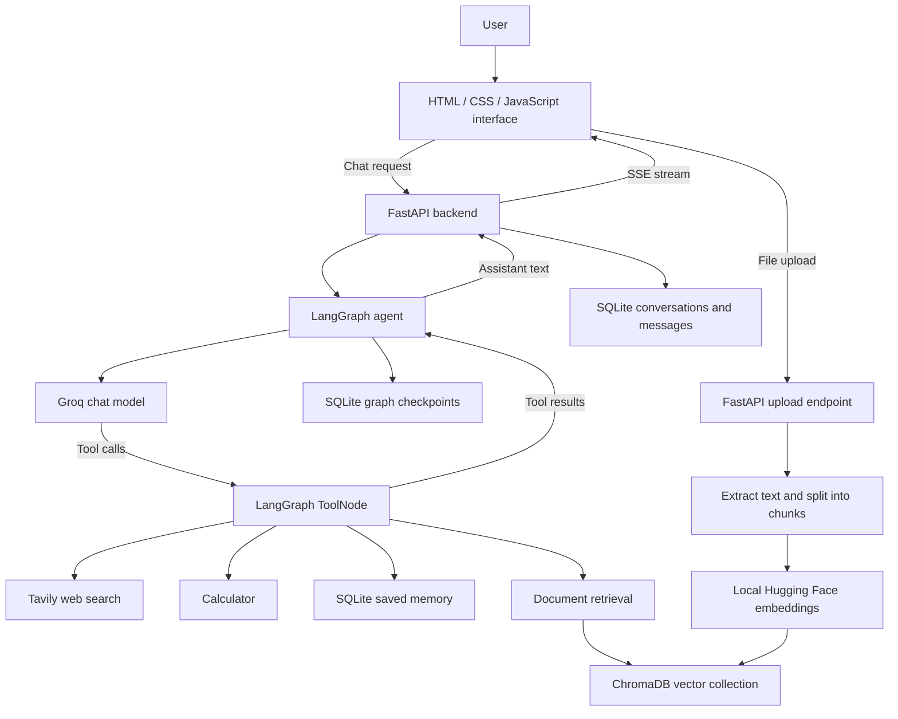

# IllusionaryGPT — Agentic AI Knowledge Assistant

A full-stack conversational AI portfolio project that brings document question answering, web search, calculations, and persistent conversation memory into one interface.

Built with **FastAPI, LangGraph, LangChain, Groq, Hugging Face embeddings, ChromaDB, and SQLite**, the application demonstrates how to connect a language model to application data and tools, stream its responses to a browser, and preserve state between conversations.

## Problem and motivation

A conversational assistant often needs information beyond the model's training data: an uploaded document, a recent event, a calculation, or a preference saved in an earlier exchange. Switching between separate tools interrupts that workflow.

IllusionaryGPT explores a unified approach: the user asks a question, and a tool-enabled agent decides whether to answer directly, retrieve document passages, search the web, calculate a result, or access saved memory. The goal is to demonstrate the engineering behind an AI application with retrieval, orchestration, persistence, and a usable frontend.

## Project scope

The current implementation is a local, single-user portfolio application with these capabilities:

- **Streaming chat:** Display model text incrementally through Server-Sent Events (SSE).
- **Tool orchestration:** Use a LangGraph workflow to execute tools and return their results to the model.
- **Document question answering:** Upload PDF, DOCX, TXT, Markdown, Python, and CSV files and retrieve relevant passages.
- **Web search:** Retrieve current information using Tavily.
- **Calculations:** Invoke a Python-based calculator tool for mathematical expressions.
- **Persistent conversations:** Store messages and conversation titles in SQLite and reopen chats from the sidebar.
- **Explicit memory:** Save user-requested facts and retrieve recent saved memories within a conversation thread.
- **Model selection:** Choose Groq-hosted GPT OSS 120B or 20B from the interface.
- **Browser interface:** Use a dark chat layout with document attachment, tool progress indicators, and browser-dependent voice dictation.
- **Container packaging:** Run the backend using the included Dockerfile.

## System design



### Agent workflow

1. The browser sends a message, conversation thread ID, and selected model to `/chat/stream`.
2. The backend records the user message and invokes the cached graph for the selected model.
3. The chatbot node sends the system instructions and graph message state to Groq.
4. If the model requests a tool, LangGraph routes execution to `ToolNode` and feeds the results back to the chatbot node. This loop continues until the model returns an answer.
5. The backend streams assistant text to the browser, filters out tool messages, and stores the completed answer in the chat history.

The model request has a 45-second timeout with automatic retries disabled. The browser aborts a stream after 60 seconds without incoming data and displays an error.

### Retrieval-augmented generation (RAG)

Document retrieval follows a separate ingestion and search pipeline:

1. Extract text using `pypdf`, `docx2txt`, or plain-text reading.
2. Split text into chunks of **900 characters with 150 characters of overlap**.
3. Generate normalized embeddings using **`sentence-transformers/all-MiniLM-L6-v2`**, running locally on CPU through `HuggingFaceEmbeddings`.
4. Persist vectors in ChromaDB with the source filename and conversation thread ID.
5. At question time, retrieve the **top four passages** matching the query, filtered by thread ID.
6. Return source-labelled passages to the agent as tool context for its answer.

The embedding model initializes on first document use. Its initial download requires internet access; embedding computation runs locally afterward. Document passages used to answer a question are sent to the Groq-hosted model.

### Persistence design

| Storage | Responsibility |
| --- | --- |
| `data/chatbot_memory.db` | SQLAlchemy-managed conversation records, displayed chat messages, and explicitly saved memories |
| `data/langgraph_checkpoints.sqlite` | LangGraph execution and message state, keyed by conversation thread |
| `chroma_db/` | Persistent document vectors and metadata |
| `uploads/` | Uploaded source files |
| Browser local storage | Selected conversation thread and model preference |

Displayed chat history and graph checkpoints serve different purposes: one supports the interface, while the other lets the agent continue a conversation with its prior state. Saved memory is an additional explicit store; its current recall implementation returns up to 20 recent memories from the thread rather than performing semantic search.

## Technology stack and design choices

| Technology | Role and rationale |
| --- | --- |
| Python | Backend logic, document processing, and AI integrations |
| FastAPI + Uvicorn | HTTP endpoints, multipart uploads, and streamed responses |
| LangGraph | Explicit chatbot → tool → chatbot control flow and persistent checkpoints |
| LangChain + `langchain-groq` | Chat model integration, message types, and tool binding |
| Groq | Hosted inference for `openai/gpt-oss-120b` and `openai/gpt-oss-20b` |
| Hugging Face + Sentence Transformers | Local document/query embeddings without an embedding API key |
| ChromaDB | Persistent vector search with conversation metadata filtering |
| SQLite + SQLAlchemy | Lightweight local persistence without a separate database service |
| Tavily | Search tool for questions requiring current web information |
| Jinja2 + HTML/CSS/JavaScript | Server-rendered page with browser-side chat and streaming logic |
| SSE over Fetch | Incremental server-to-browser output using an HTTP response stream |
| Docker | Package the application and its Python dependencies |

The design separates the chat provider from the embedding provider. This allows Groq to handle response generation while document embeddings run locally. Lazy embedding initialization avoids loading the local model for ordinary chat requests.

## Repository structure

```text
illusionary-chat-gpt/
├── app.py                 # FastAPI routes, uploads, SSE serialization and filtering
├── agent.py               # Groq configuration, LangGraph workflow and agent cache
├── tools.py               # Search, calculator, document retrieval and memory tools
├── rag.py                 # Text extraction, chunking, embeddings and vector search
├── database.py            # SQLAlchemy models and persistence operations
├── templates/
│   └── index.html         # Chat interface, SSE reader and browser interactions
├── requirements.txt       # Python dependencies
├── Dockerfile             # Container build and Uvicorn entry point
├── .dockerignore          # Docker build exclusions
├── .gitignore             # Git exclusions for secrets and generated data
└── README.md
```

`data/`, `uploads/`, and `chroma_db/` hold runtime data and are created as needed.

## Run locally

### 1. Clone and create an environment

Use Python 3.11 or 3.12; the Dockerfile uses Python 3.11.

```sh
git clone https://github.com/raghu-illusion-world/illusionary-chat-gpt.git
cd illusionary-chat-gpt
python -m venv .venv
source .venv/bin/activate
python -m pip install -r requirements.txt
```

On Windows, activate the environment with `.venv\Scripts\activate`.

### 2. Configure credentials

Create a `.env` file in the project root:

```dotenv
GROQ_API_KEY=your_groq_api_key
TAVILY_API_KEY=your_tavily_api_key
GROQ_MODEL=openai/gpt-oss-120b
```

- `GROQ_API_KEY` authenticates chat requests.
- `TAVILY_API_KEY` authenticates web search. The search client is currently created at import time, so configure this key for the full application setup.
- `GROQ_MODEL` is optional and sets the backend fallback model. The interface offers its own explicit model selection; add a corresponding dropdown option if using a different model.
- No Google API key or Hugging Face token is required for the configured public embedding model.

Keep `.env` out of version control.

### 3. Start the server

```sh
python app.py
```

Open **http://localhost:8080**. The local entry point enables automatic reload for development.

Alternatively, start Uvicorn directly:

```sh
uvicorn app:app --host 127.0.0.1 --port 8080
```

### 4. Try the main workflows

| Workflow | Example |
| --- | --- |
| General chat | “Explain how a vector database works.” |
| Calculation | “Calculate 125 * 18 + 450.” |
| Document retrieval | Attach a text-based PDF, then ask “What are the main findings in the uploaded document?” |
| Web search | “Search for the latest developments in retrieval-augmented generation.” |
| Save memory | “Remember that I prefer Python examples.” |
| Recall memory | “What preferences have I asked you to remember?” |
| Conversation persistence | Send a message, refresh the page, and reopen the conversation from the sidebar. |

The first document upload may take longer while the embedding model downloads and initializes. Documents previously indexed with Google embeddings must be uploaded again for the Hugging Face collection.

## Run with Docker

The current `.dockerignore` only excludes environment directories. Before building, add `.env`, `.git/`, `data/`, `uploads/`, and `chroma_db/` to it so credentials and local application data are excluded from the image.

```sh
docker build -t illusionary-gpt .
docker run --rm -p 8080:8080 --env-file .env \
  -v illusionary-data:/app/data \
  -v illusionary-uploads:/app/uploads \
  -v illusionary-vectors:/app/chroma_db \
  -v illusionary-model-cache:/root/.cache/huggingface \
  illusionary-gpt
```

The volumes preserve conversations, uploaded files, vectors, and downloaded models between container runs.

## API overview

| Method | Endpoint | Purpose |
| --- | --- | --- |
| `GET` | `/` | Render the chat interface |
| `GET` | `/conversations` | List stored conversations |
| `GET` | `/history/{thread_id}` | Return stored messages for a thread |
| `POST` | `/upload` | Upload and index a document using multipart form data |
| `POST` | `/chat/stream` | Stream an assistant response for a JSON chat request |

Example chat request:

```sh
curl -N http://localhost:8080/chat/stream \
  -H 'Content-Type: application/json' \
  -d '{"message":"Explain RAG in two sentences.","thread_id":"demo","model":"openai/gpt-oss-120b"}'
```

The stream uses JSON payloads inside SSE events:

```text
data: {"token": "Retrieval"}

data: {"token": "-augmented generation..."}

data: {"done": true}
```

Errors are returned as JSON before streaming starts or as `{"error": "..."}` events during generation.

## Engineering boundaries and next steps

This repository demonstrates an integrated AI application; it does not claim production readiness or measured performance improvements.

- **User isolation:** Thread IDs organize data, but there is no authentication or authorization. A process-global current thread variable also needs replacement with request-scoped tool context before concurrent multi-user use.
- **Retrieval quality:** The current pipeline uses basic chunking and similarity search. Reranking, retrieval evaluation, and citation verification are future improvements. Source-labelled context does not guarantee every generated answer contains citations.
- **Document processing:** Scanned PDFs require an OCR stage that is not implemented. Upload size limits, file validation, and duplicate-ingestion handling need further work.
- **Tool execution:** The calculator currently uses Python `eval` with restricted globals. Replace it with a constrained expression parser before exposing the application to untrusted users.
- **Operations:** Automated integration tests, structured monitoring, rate limiting, and a broader deployment configuration are future work. SQLite and local file storage suit the current local scope.
- **Validation:** No latency, accuracy, throughput, or cost benchmark is published. The workflows above provide a manual demonstration checklist, not a report of completed end-to-end testing.

## Portfolio and resume summary

**IllusionaryGPT | Agentic AI Knowledge Assistant**  
*Python, FastAPI, LangGraph, LangChain, Groq, Hugging Face, ChromaDB, SQLite, Docker*

- Built a full-stack AI assistant with streamed chat responses, document question answering, web search, calculator tools, and persistent conversation history.
- Implemented a LangGraph tool-calling workflow that routes model requests to retrieval, search, calculation, and memory tools before generating responses.
- Developed a RAG pipeline using local Hugging Face embeddings, overlapping text chunks, and ChromaDB similarity search with conversation metadata filtering.
- Integrated SQLAlchemy-backed chat and memory storage, SQLite graph checkpoints, and Docker packaging for local deployment.


